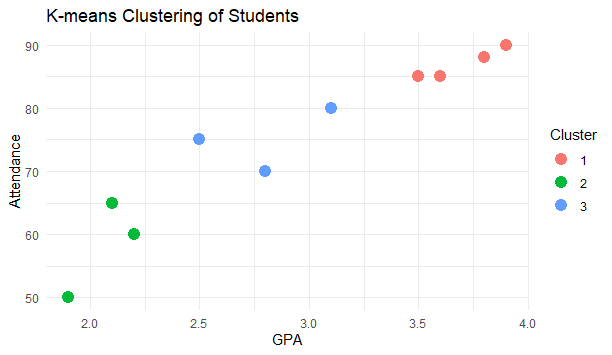
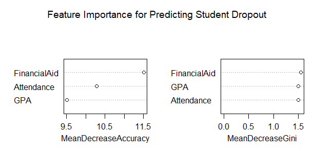
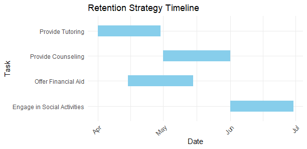
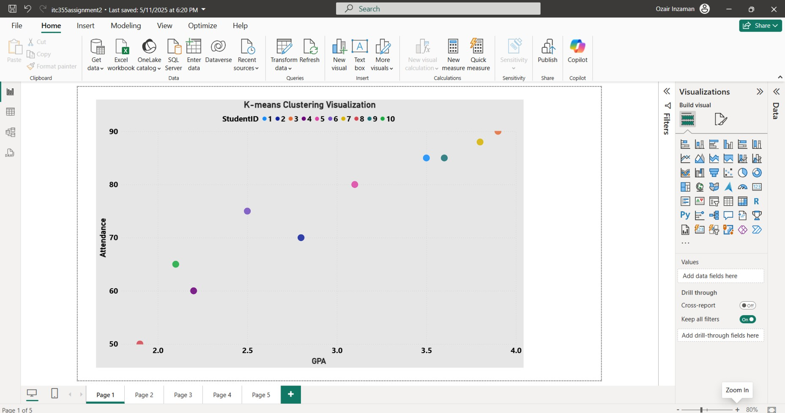
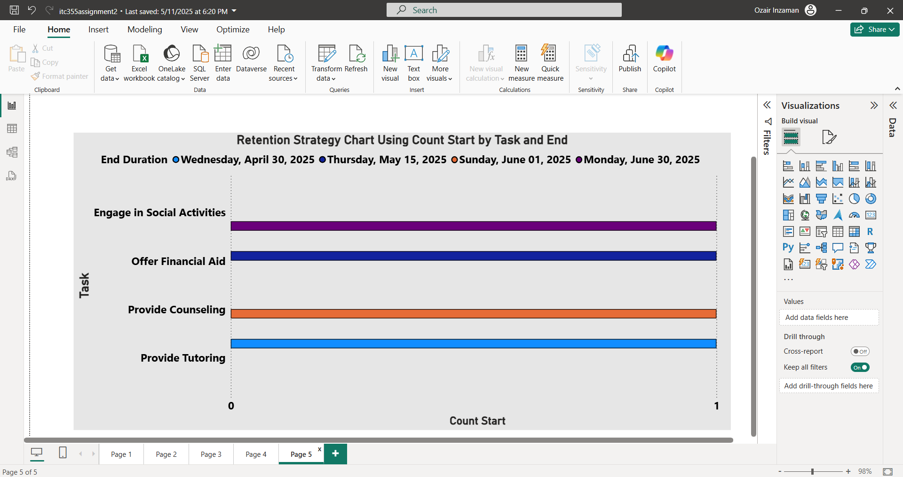

# University Student Dropout & Retention Analysis (Business Intelligence)

A two-part Business Intelligence project analyzing university student dropout risk and designing data-driven retention strategies — first in **R**, then in **Microsoft Power BI**.

## Problem

University students face challenges (low GPA, poor attendance, financial difficulty, mental health strain) that increase dropout risk. This project applies descriptive, predictive, and prescriptive analytics to identify at-risk students and recommend targeted interventions.

## Contents

### 1. [R Analysis](./assignment1-r-analysis/) — Descriptive, Predictive & Prescriptive Analytics
- **Report:** [Assignment1_R_Student_Dropout_Analysis.pdf](./assignment1-r-analysis/Assignment1_R_Student_Dropout_Analysis.pdf)
- **Script:** [student_dropout_analysis.R](./assignment1-r-analysis/student_dropout_analysis.R)

Covers:
- **Descriptive** — K-means clustering of students by GPA & attendance; churn (dropout) bar chart
- **Predictive** — Random Forest model predicting dropout, with feature importance, a confusion matrix, and an ROC curve
- **Prescriptive** — a Gantt chart mapping out a retention-strategy timeline (tutoring, financial aid, counseling, social engagement)

  
  
  

### 2. [Power BI Dashboard](./assignment2-powerbi-dashboard/) — Interactive Visual Analysis
- **Report:** [Assignment2_PowerBI_Retention_Strategy.pdf](./assignment2-powerbi-dashboard/Assignment2_PowerBI_Retention_Strategy.pdf)
- **Dashboard file:** [itc355assignment2.pbix](./assignment2-powerbi-dashboard/itc355assignment2.pbix) *(open in Power BI Desktop)*

A 5-page interactive Power BI report built on the same analysis, covering:
- K-means clustering of students (GPA vs. attendance)
- Attendance's impact on GPA and dropout
- Financial aid's relationship to GPA and retention
- A retention-strategy timeline chart

  
  

## Data

All datasets are in [`/data`](./data):

| File | Description |
|---|---|
| `student_performance.csv` | StudentID, GPA, Attendance, FinancialAid, MentalHealthStatus |
| `churn_analysis.csv` | StudentID, Attendance, FinancialAid, Dropout |
| `feature_importance.csv` | StudentID, GPA, Attendance, FinancialAid, Churn |
| `retention-strategy.csv` | Task, Start, End — the retention strategy timeline (exported from the R Gantt chart) |

> Note: this is a small, illustrative dataset (10 students) compiled for coursework purposes, not real student records.

## Key Findings

- **GPA and attendance** are the strongest predictors of dropout risk
- Students with **low GPA + low attendance** cluster together as the highest-risk group
- **Financial aid** correlates strongly with retention — students without aid and with lower GPA are most likely to drop out
- Recommended interventions: targeted tutoring, financial aid, counseling, and social engagement — sequenced on a retention-strategy timeline

## Tools & Technologies

